# The Superintendent

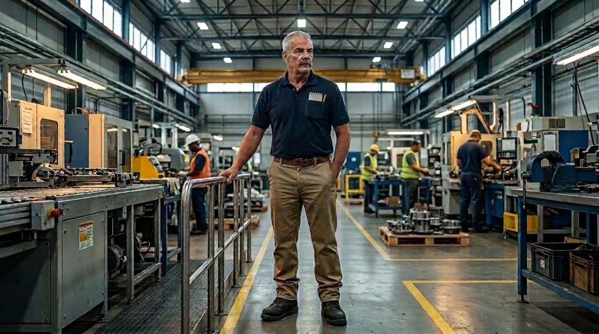

## Introduction

The happy place for developers is writing code. We get a ticket to work on and for the whole sprint we're laser focused on getting the task done. This is an easy trap to fall into if you're not fully in tune with who you are building the feature for and what value they expect to get from it.

So I wrote a story about an unsuspecting protagonist who ends up understanding UX design better than anyone on the team, and gets the job done the right way.

It was a true fifty-fifty collaboration with Claude. I wrote the backstory and a lot of the funny bits — especially everything about Bill, the main character — and Claude and I built out the rest of the story together. I also created the characters in Google Flow.

---

## I. The Hire

The Big Creek Regional Health project was eleven weeks behind when Priya Raman stopped reading the status report notifications on Slack. She didn't stop because they were bad. She stopped because they were green. Every one of them — sprint goal met, velocity stable, burndown healthy, a cheerful little rocket emoji next to the word *Shipped*.

*Priya Raman*

But every Monday, like clockwork, she was receiving emails from a hospital in Middleburg Heights, Ohio, that said some version of the same thing: *We still can't register patients on the new screens. Please call.*

Nobody called the customer. The office didn't have a phone.

Halyard Systems had spent its first eight years doing the kind of work that gets you written up on prominent tech news sites. Fintech dashboards. A ride-share integration. One very good dog-walking app that a much larger company bought for a number Priya was still not allowed to say out loud. They had an office in the Beacon Hill neighborhood of Boston with exposed brick and a kombucha tap that hadn't been serviced since the pandemic. But since their start in 2017 they had grown up.

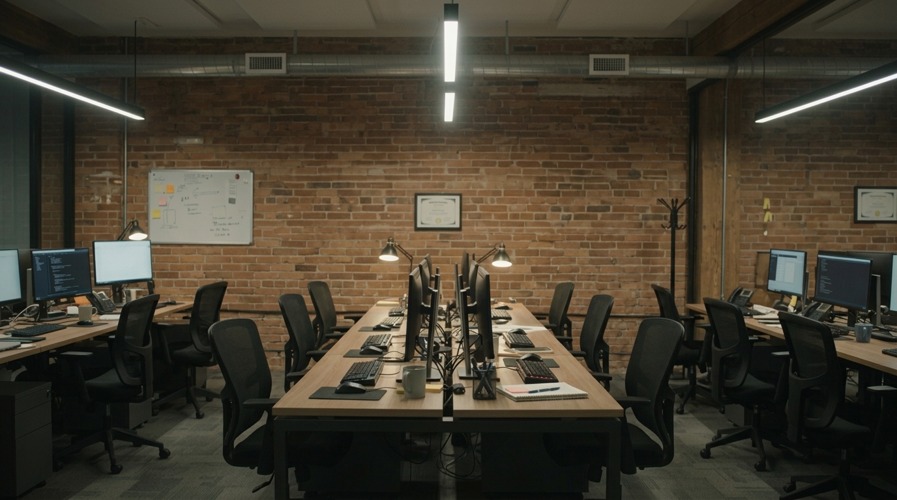

Growing up meant contracts like Big Creek Regional Health: a three-hospital system southwest of Cleveland running patient registration on a platform older than most of the developers hired to replace it. The budget was thin. The stakes were not. The code was a twenty-two-year-old tangle of stored procedures that a contractor named Gary had maintained until Gary retired to Myrtle Beach and stopped answering email.

Priya put her best team on it. Ten developers. Modern stack, agentic development, two-week sprints, and a Scrum Master with a certificate he framed and hung up by his desk. They were fast. They were good. But the customer wasn't getting what they needed.

Priya had raised it at the leadership offsite with Dan Whitcomb, the CEO, who listened while eating a grain bowl standing up. "If it's not a talent problem, then what is it?" he said.

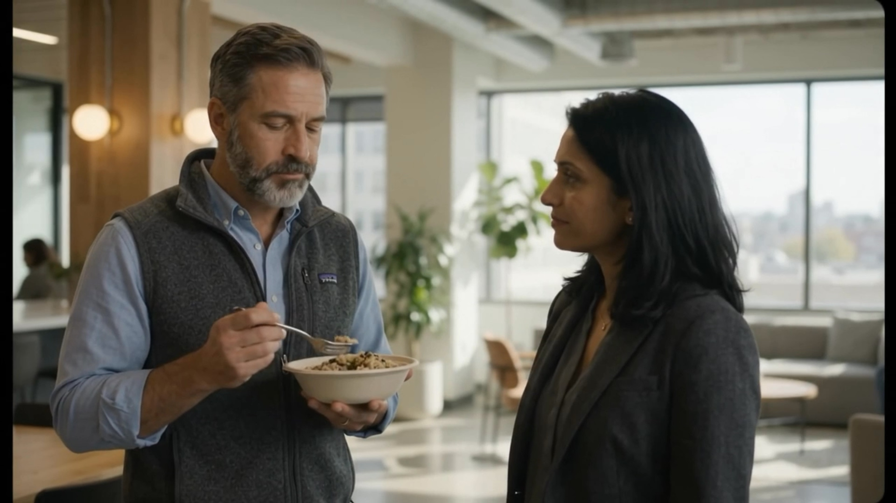

*Dan and Priya*

"I don't think it's a software problem," Priya said. "I think it's a project management problem."

"Meaning what?"

"Meaning I want to hire someone for this team who's never worked in software."

Dan put the grain bowl down.

---

Bill Kowalski had run the floor at Erie Precision Forge in Parma for nineteen years before the plant got sold to a holding company in Charlotte and the holding company decided it didn't need a plant. He'd started there at nineteen on a CNC lathe, moved to welding, made Line Foreman at twenty-eight and Plant Superintendent at thirty-nine. No formal degree, but had an honorary PhD from the school of experience.

He managed two hundred and forty people on three shifts. Quotas, overtime, safety audits, union grievances, and the specific art of standing in the shipping bay at 5:40 a.m. figuring out why the trucks were late.

He came to the interview in khakis, a navy polo tucked in tight under a braided belt, and a pair of Thorogood steel-toed boots that had been resoled twice. He knew first impressions were important so he cleaned and oiled them the night before. Priya liked the boots.

"I'll be straight with you," Bill said, before she'd asked anything. "I don't know what the hell a sprint is. I looked it up on the plane on the way over here - but I still don't get it."

"That's fine."

"Then why did you want to interview *me* for this?"

She slid a printout across the table: the Big Creek status report, all green, rocket emoji included. Next to it, the hospital's last six emails.

Bill read both. It took him a while. He read the way some people read contracts — finger moving, lips not.

"These two pieces of paper," he said finally, "are about different jobs."

"Yes."

"So somebody's not walking the line."

Priya didn't know exactly what that meant. She hired him anyway.

## II. The Ceremonies

On his first morning, Bill hung a poster.

It was the kind you used to find in the back of a SkyMall catalog: a rowing crew at dawn, oars in perfect unison, mist on the water. Underneath, in serif capitals: **TEAMWORK. Ordinary people working together achieve extraordinary results.** He made the oak frame for it in his garage and had it on display in his office at Erie Precision for eleven years. He hung it on the brick wall by the team's pod with a level and two masonry anchors. Command strips would have been a shortcut and he knew the wall was load-bearing anyway.

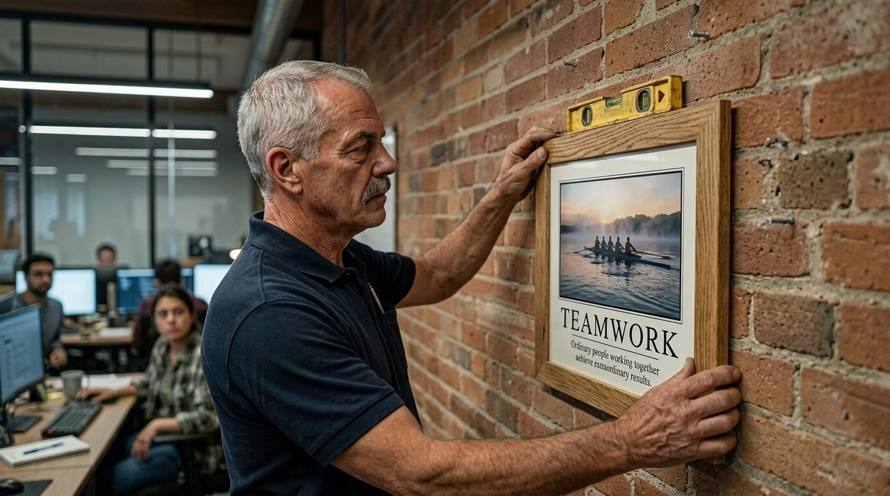

The team sat at their desks with their coffees pretending to work while watching him out of the corner of their eyes. Bill leveled it against the brick while the team sat in the silence of people trying to work out whether it was a joke or not.

"Is that meant to be ironic?" whispered Kyle Brenner, the Scrum Master.

"I genuinely can't tell," said Tessa Lindqvist, the staff engineer. Tessa had built half the team's agent pipeline and was the person everyone asked when the agent pipeline did something nobody understood. She had a sticker on her Macbook Pro that said *I could have automated this meeting.*

It was not ironic. Bill did not do ironic. He stepped back, checked the poster with the level one more time, and said, "Okay. Who's in charge of the first thing today?"

---

The first thing was standup.

It happened at 9:45 on a video call, even though eight of the ten developers were sitting within twenty feet of each other. Bill asked about this. Kyle explained that two people were remote and it was important to be inclusive. Bill nodded and sat in a chair facing a monitor, watching the people behind the monitor talk to the monitor.

Each developer said what they did yesterday, what they were doing today, and whether they were blocked. Nobody was blocked. Marcus Hale, the tech lead, was working on the patient search refactor. Priyanka was working on the insurance verification service. Owen was "pairing with Claude on a problem with the build pipeline artifacts." Bill wrote that one down to ask about later.

It took twenty-two minutes.

"Nobody's blocked," Bill said to Kyle afterward.

"Nope. Good standup."

"But the job's eleven weeks late."

Kyle smiled the patient smile of a man who had explained this many times. "Right, so — the standup isn't really about the project timeline. It's about the sprint. The sprint's on track."

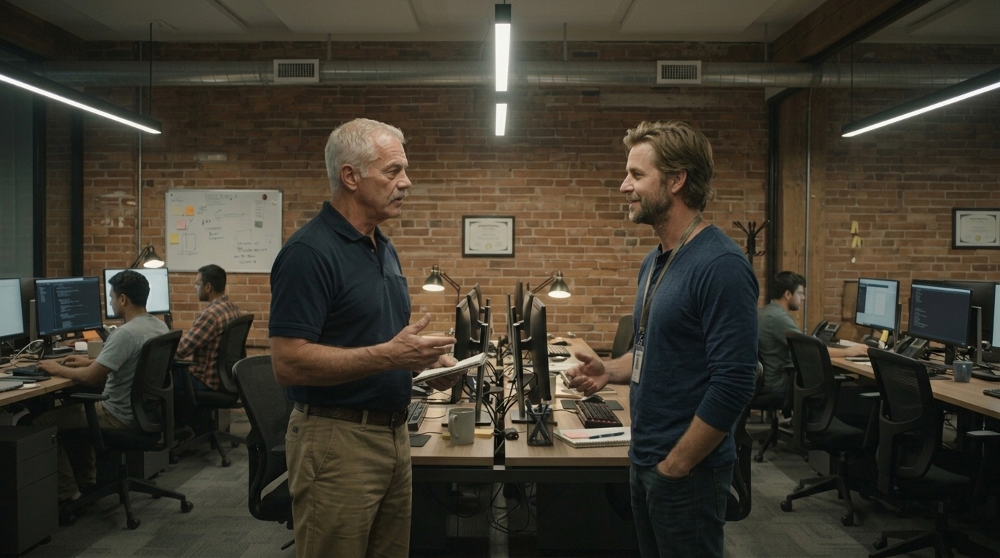

Bill thought about that for a second. "At the plant, every line was on track every shift. Every single line, on paper. And we were still shipping late. You know why?"

"Why?"

"Because each line was measuring itself."

---

Over the next two weeks Bill sat in on everything. Backlog refinement. Sprint planning. A sprint review, where Marcus demoed the new registration screen to Jordan Pike, the product owner, who said it looked great. A retrospective, run on a digital whiteboard with sticky notes in three columns: *What went well. What didn't. What we'll try.* Under *What didn't*, someone had written "Hospital keeps reporting bugs we can't reproduce." Under *What we'll try*, someone had written "Ask hospital for better steps to reproduce bugs." It had already been written on previous boards (Bill noticed when he scrolled back) for five retros in a row.

He kept a pocket notebook, a Rite in the Rain with a pencil in the spine in his shirt pocket. People started to notice it.

In planning, when the team spent forty minutes debating whether a ticket was a five or an eight, the notebook came out and Bill wrote something short. Tessa, sitting next to him, tilted her head to read it.

It said: *40 min. 10 people. Nobody called the hospital.*

She didn't say anything. But she didn't look away from it, either.

The question Bill asked most, in those two weeks, was some version of: *Who said?* Who said the clerks need this field? Who said the insurance check can run async? Who said the old system did it that way? And the answer, every time, came back to one of three places: the legacy code, a requirements document written by a hospital administrator who'd since left, or Jordan.

"And who told you?" Bill asked Jordan, over coffee he'd made himself in the office's very expensive espresso machine, with some difficulty.

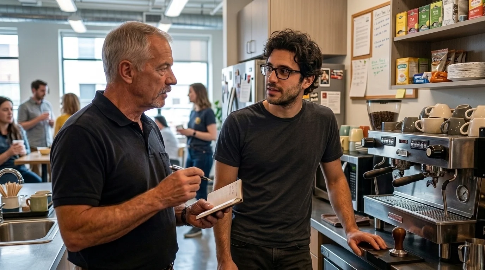

"I mean, I had Claude synthesize it after exporting all the project artifacts we could get our hands on," Jordan said. "Their tickets, the old docs, the code behavior. So I kind of own the backlog."

"When's the last time you talked to somebody at the hospital?"

Jordan thought about it. "Like, actually talked? Kickoff. In March. On Zoom."

"Who was on it?"

"Their CIO, I think? And their CFO."

Bill wrote that down too. Then he asked the question that would, within a month, end up on a laminated card taped to every monitor in the pod.

"Who at that hospital actually uses the thing?"

Nobody knew.

## III. The Phone

Bill bought the phone at a Staples on Summer Street. A Panasonic cordless with a base station and an answering machine, $39.99. He plugged it into a wall jack that, it turned out, had not been connected to anything since 2019. The building facilities manager had to come up. It took most of a Tuesday.

"You know you can just call from your laptop," Owen said, watching. "Or your cell."

"Sure," Bill said. "But then it's my call. This is the *team's* phone. It sits here. It rings here. Everybody hears it ring."

Owen looked at it like it might be radioactive.

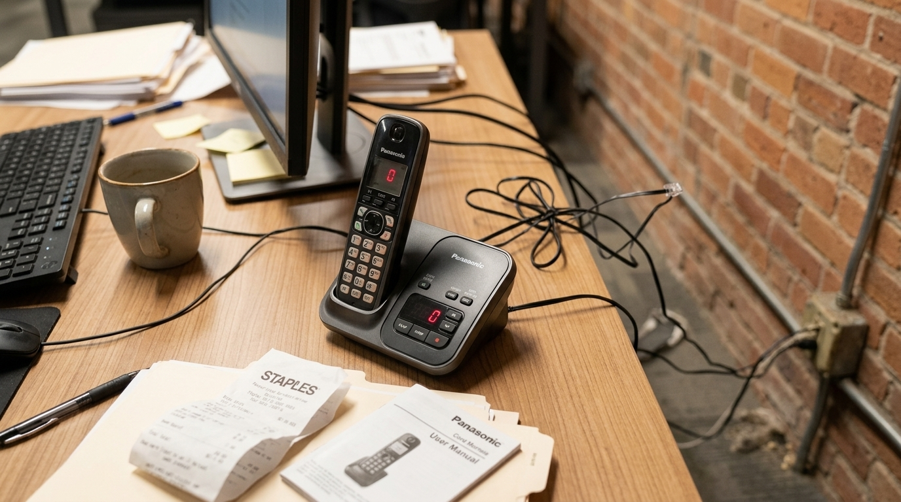

The main number for Big Creek Regional Health went to a phone tree with nine options, none of which were *I'm the vendor rebuilding your registration system and I'd like to talk to somebody who registers patients.* Bill pressed zero until a human picked up. He asked for whoever ran the admitting desk at the Middleburg Heights campus. He got transferred four times. On the fifth, a woman answered on the first ring, sounding like she was holding the receiver with her shoulder.

"Patient Access, this is Donna."

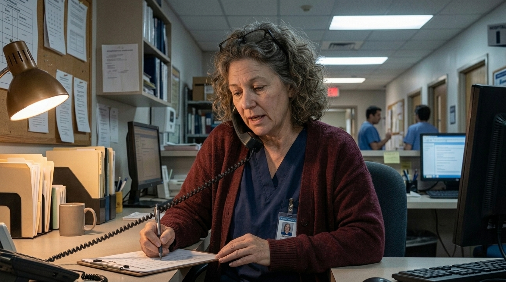

"Donna, my name's Bill Kowalski. I work for Halyard — the company building your new registration system."

There was a pause long enough that Bill checked whether the call had dropped.

"Are you kidding me," Donna said. Not a question.

"No ma'am."

"Eight months. Eight months I've been sending emails to a ticket system that sends me back an email that says my ticket has been received. And you just — call."

"Yes ma'am. I'm sorry it took this long. I just started."

"Where are you from? You don't sound like Boston."

"Parma. Ridgewood, off Pearl Road."

Another pause, different in kind.

"My brother-in-law worked at Erie Forge," Donna said.

"Which shift?"

"Second. Stan Wojcik."

"Stan with the Browns tattoo. Bad knee." Bill was already smiling. "He's a good man. He filed more grievances against me than anybody in the building, and he was right on about half of them."

Donna Szymanski laughed for the first time in what she would later tell him was about four months. Then she talked for an hour and ten minutes.

---

Bill put her on speaker about ten minutes in, without asking anyone, and the pod went quiet.

Donna had worked in patient access at Big Creek for thirty-one years. She ran eleven registration clerks across three shifts at the Middleburg Heights campus and two more in the ER. And she explained, in a flat Northeast Ohio voice that didn't waste a syllable, why nothing the team built so far had worked.

The registration terminals at the ER intake desk were seven-year-old Dell all-in-ones on a locked-down Windows image. The hospital's two-person IT department had set the browser to a compatibility mode so the old system would load, and nobody had told the vendor, because nobody had asked. Half of the new screen's layout collapsed when it was opened. Those were the "bugs we can't reproduce."

The clerks didn't use a mouse when they could help it. They'd been on the old green-screen-era system so long they tabbed through every field by muscle memory, and they could register a walk-in in ninety seconds without looking down. The new screen had a beautiful, modern, multi-step flow with a progress bar. It took four and a half minutes and needed the mouse at every step. On a Friday night in the ER that wasn't a design preference. It was a line out the door.

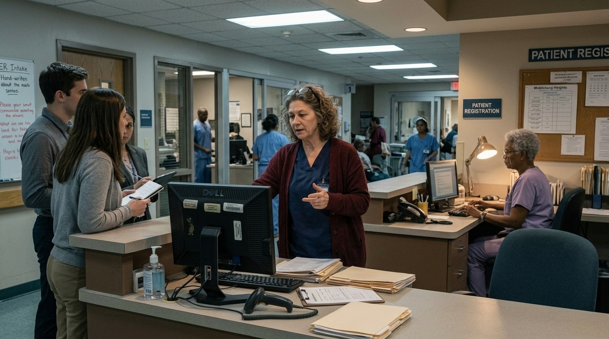

The wristbands for patients were printed on Zebra Wristband Printers, wired by USB to each terminal. The new system generated wristbands in a companion app that displayed a QR code.

"A QR code," Donna said. "For a wristband... Do you have any idea what happens when a nurse needs to scan something from an app that needs WiFi at two in the morning?"

Nobody in the pod answered. Bill didn't either. He let the silence sit there and do its work.

And the updates, she said. Every time the team makes an update, things moved. A field would jump. A button would change color. The clerks had laminated cheat sheets taped to their monitors, and every two weeks the cheat sheets were wrong.

"I've got a woman on nights," Donna said, "Loretta, been here twenty-six years. She told me last week she's thinking of retiring early. Not because of the hours. Because she can't keep up with the computer. She's the best registrar I've ever had. I can't replace her."

Bill wrote *Loretta — nights — 26 yrs* in his notebook and underlined it twice.

When he hung up, Marcus was standing behind his chair. He'd been standing there for most of the call.

"The compatibility mode thing," Marcus said quietly. "That's three of our open P1s. Maybe four."

"Uh huh."

"We spent two sprints on those."

"Uh huh."

"We could've found that out in one phone call."

Bill turned the chair around. He wasn't smiling now, but he wasn't hard about it either. It was the same face he used to make when a nineteen-year-old on the line finally figured out why his parts kept coming out of tolerance.

"Now you know what the phone's for," he said.

## IV. The Floor

Bill asked Priya for three plane tickets to Cleveland. She approved them before he finished the sentence.

He took Marcus, because Marcus had been standing behind his chair. And he took Tessa, because Tessa was the one most likely to think the whole trip was a waste of time, and Bill had learned a long time ago that you bring the skeptic. A believer comes home and tells everybody it was great. A skeptic comes home and tells everybody what she saw.

They landed at Hopkins at 4:15 on a Thursday. Bill had rented a Buick. He drove them straight to the hospital, not the hotel.

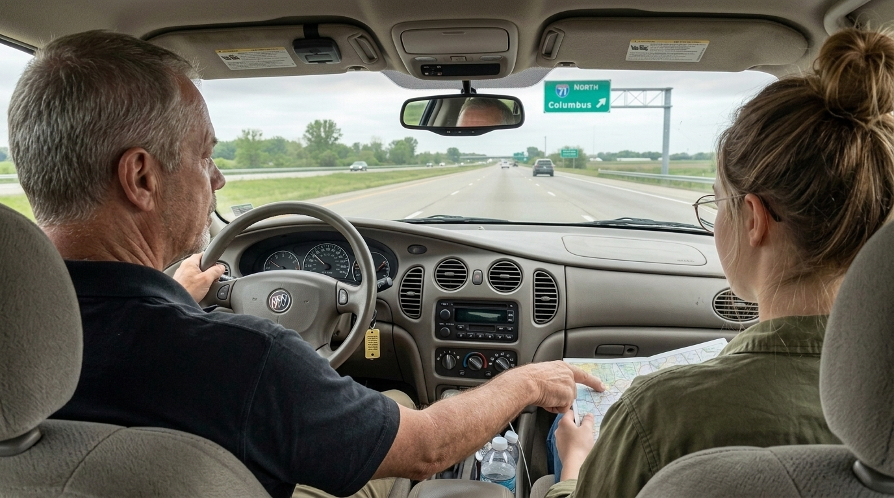

"Shouldn't we check in first?" Tessa asked.

"Second shift starts at three," Bill said. "I want you to see the handoff before it's over."

---

Big Creek's Middleburg Heights campus was a four-story brick building off Bagley Road, with an ER addition from the nineties and a parking lot that had been restriped so many times the lines looked like a seismograph. Donna met them at the ambulance entrance in scrubs and a cardigan. She shook Bill's hand, then pulled him into a hug, because in Northeast Ohio a man who knows your brother-in-law is family.

She walked them to the ER registration desk and put them in two plastic chairs against the wall, behind the clerks, out of the way.

"Don't talk," she said. "Just watch."

They watched for six hours.

They watched a clerk named Renee register a man with a dislocated shoulder in eighty seconds on the old system, which the hospital still ran in parallel because the new one wasn't trusted. They watched her try the same thing on the new system twenty minutes later, as a test Donna had asked for. It took four minutes and forty seconds. The progress bar was very pretty. The man with the next dislocated shoulder waited...

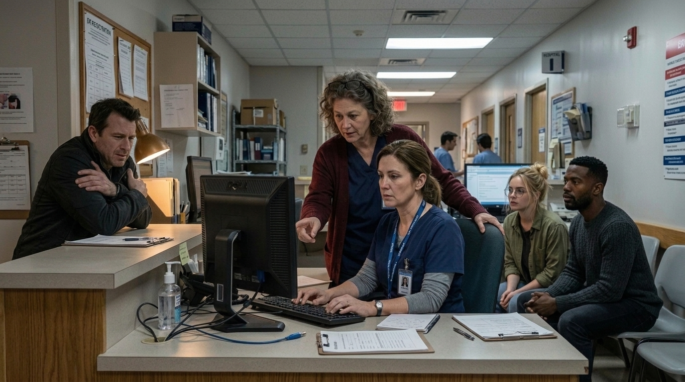

They watched the browser render the new screen with the insurance panel shoved off the right edge, unreachable without a horizontal scrollbar that the locked-down image had made two pixels tall.

They watched a wristband print from the old system on a Zebra printer that sounded like a cicada. Then they watched a clerk print the new system's PDF wristband on a laser printer, cut it out with scissors, and tape it around a toddler's wrist.

Tessa stopped taking notes on her laptop around 8 p.m. She'd borrowed a pen from Donna and was writing on the back of a blank intake form.

At 11, the night shift came on. Loretta Haines was sixty-three, wore reading glasses on a beaded chain, and tabbed through the old system faster than Tessa could follow. She had a Post-it note on her monitor that said *F9 = COPY PREV ADDR*. Nobody on the team knew the old system had an F9 shortcut. It wasn't in the code they'd analyzed, because it wasn't in the code. Gary had built it into a terminal emulator macro in 2006, and it saved Loretta about a minute on every return patient.

"How many return patients do you get a night?" Marcus asked her. Donna gave him a look, but let it go.

"Oh, honey," Loretta said, not looking away from the screen. "Most of them. This is Middleburg. Everybody's been here before."

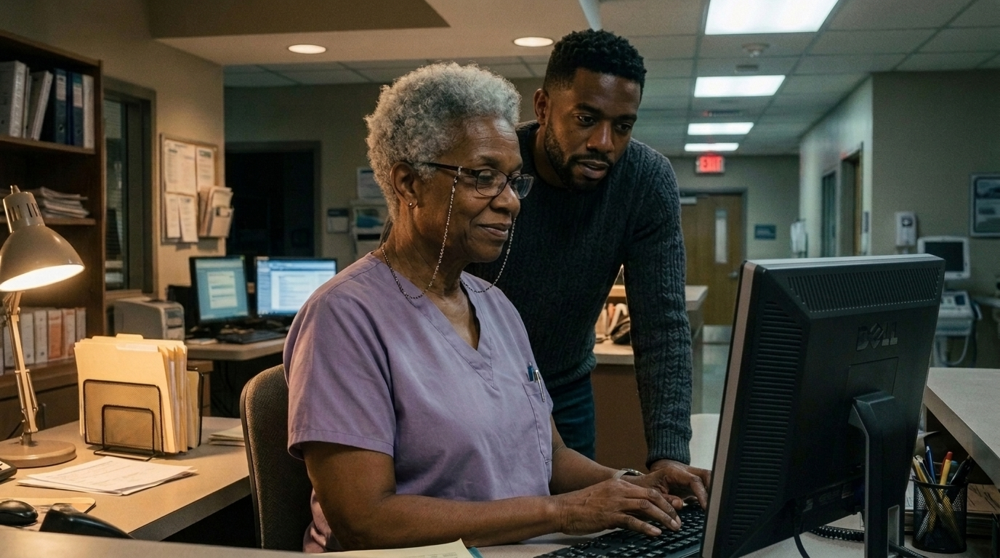

Marcus did the math in his head and went quiet.

---

At one in the morning they sat in the cafeteria, which was closed, at a table Donna had unlocked for them. Bill had bought three cans of RC Cola from a vending machine. Nobody had asked for it.

Tessa had the intake form she used to take notes the day before on the table in front of her. Both sides were covered.

"We've been building the wrong thing," she said. "Not wrong-wrong. The code's fine. The architecture's fine. It's just — we've been building it for a user who doesn't exist. Some imaginary person with a 27-inch monitor and a mouse and all the time in the world."

"Who'd you think the user was?" Bill asked.

She thought about it honestly. "Us," she said. "I think we were building it for someone like us."

Bill nodded slowly. He took a sip of his RC Cola.

"At the plant," he said, "we had a new engineer one time. Sharp kid. Purdue. He redesigned a fixture for the press line. Beautiful thing. Shaved four seconds off every cycle, on paper. But he designed it sitting in an office upstairs, and the guys on the line were all about five-nine and the fixture was built for a six-foot-two guy. So they had to reach. And reaching, eight hours a day, wrecked their shoulders. In a month we had two guys on workers' comp and the line was slower than before."

"What did you do?"

"I made him work the line for a week. Second shift. With Stan Wojcik, actually." Bill smiled. "He rebuilt the fixture in three days after that. Best engineer we ever had."

Marcus turned his RC Cola can around in his hands. "Is that what this is? You making us work the line?"

"No," said Bill. "You can't work this line. You'd get somebody killed. But you can sit behind it. That's the next best thing."

## V. The Board

The Monday after Cleveland, Bill showed up at 7:30 with a rolling whiteboard he'd bought at a school surplus auction in Quincy, and a box of dry-erase markers in four colors.

He parked it next to the TEAMWORK poster. Across the top, in block capitals, he wrote three columns:

**SHIPPED TO THE HOSPITAL · STUCK · WHY**

Not *To Do, In Progress, Done*. Not story points. Not a burndown. Just what had actually reached a clerk's screen in Middleburg Heights, what hadn't, and the reason.

Under SHIPPED, there was nothing. He'd checked with Donna. In eight months, nothing the team had built was in daily use at the hospital. Every release had been rolled back, worked around, or ignored.

Under STUCK, he wrote out every open item in marker, one line each. It took him most of an hour. People drifted in, saw him writing, and stood there with their coffee.

Under WHY, he only wrote one thing to start. He wrote it in red.

*NOBODY ASKED.*

---

Kyle pushed back first, which Bill respected. Kyle was the one with the most to lose.

"I want to be careful here," Kyle said, at a meeting Bill called in the conference room with the door closed. "What you're describing, the board, the hospital visits, the phone — it's a little bit of a step backward. We moved away from this. Big upfront requirements, a manager walking around checking on people. That's waterfall thinking. Agile exists because that stuff didn't work."

"Okay," Bill said. "I don't know what a waterfall is."

"It's —"

"No, I mean it. I don't. I know what's late. I know what's broken. And I know the thing you're doing now, the meetings and the points and all of it — you've been doing it the same way for eight months, every two weeks, exactly the same, and the hospital hasn't gotten a single working screen out of it. Where I come from, if you run a process the same way for eight months and it doesn't produce a part, that's not agile. That's a machine nobody's allowed to turn off."

Kyle opened his mouth and closed it.

"I'm not saying throw it out," Bill went on. "Some of it's good. The two-week thing's good. Short runs, check your parts, adjust. We did that at Erie. We just called it a shift. But you've got ten people in a twenty-two-minute meeting every morning telling a camera they're not blocked. You're blocked. All of you. You're blocked by the same damn thing. You just don't have a column for it."

---

So they changed things. Not everything, and not overnight.

Standup moved to the whiteboard, standing up, actually standing, which nobody had done in the four years the meeting had been called that. Eight minutes. The only question was: *What's in the STUCK column, and who's calling who about it?*

The phone got a rotation. Every developer took a day a week as the person who answered it, and every developer called Donna or one of her clerks at least once a sprint. Owen hated it for three weeks. In the fourth, he spent forty-five minutes on the line with Loretta walking her through a new keyboard shortcut he'd built for her, and came off the call pink in the face and visibly pleased with himself. He didn't talk about it. He didn't need to. Everybody had heard it ring.

The estimation debates got cut to a hard ten minutes. Bill set a kitchen timer. A real one, a white plastic egg, wind-up, with a bell. When it went off, whatever number was on the table was the number.

The sprint review got a new rule: no demo counted unless Donna or a clerk was on the call. Jordan, to his credit, took this harder than anyone and then got better faster than anyone. By November he was flying to Cleveland every other week on his own and coming back with a camera roll full of photos of people's keyboards.

And Tessa — who had the sticker that said *I could have automated this meeting* — did something Bill would never have thought of. She took the six hours of notes she took from the intake form and fed them, into the team's agent pipeline as acceptance tests. Real ones, from the floor. *Register a returning patient using keyboard only in under 100 seconds. Print wristband to a Zebra ZD421 over USB. Render correctly in Edge compatibility mode at 1366×768.* The agents had been building fast all along. Now they were building against the right thing.

"Your robots are good," Bill told her, watching the tests run green for the first time. "They just didn't have anybody to talk to."

"Neither did we," Tessa said.

She peeled the *I could have automated this meeting* sticker off her laptop that week. She didn't replace it with anything. She just left the clean rectangle where it had been.

## VI. Go-Live

Big Creek's IT department allowed production changes in one window: Sunday, 2 a.m. to 4 a.m. Nobody at Halyard had known that either, for eight months. They'd been deploying on Tuesday afternoons, which was why the hospital's two-person IT team had been quietly rolling them back every Tuesday night.

The cutover was set for the second Sunday in February. Bill flew out Friday. So did Marcus, Tessa, Owen, and — without being asked — Kyle, who had spent the last month rebuilding the team's release checklist around the hospital's change window and wanted, he said, to see it hold.

At 1:45 a.m. they were in the ER registration area. Bill was in khakis, the navy polo, and the boots. Donna had brought a tray of pierogies from her sister-in-law. Loretta had her reading glasses on the beaded chain and her arms crossed.

"If this thing eats my F9," she said to Owen, "I'm retiring Monday."

"It doesn't eat your F9," Owen said. "I promise. It's F9. I tested it with your Post-it."

At 2:00, Marcus gave the go. At 2:14, the new system was live on all six registration terminals. At 2:31, a woman came in with a cut hand and a dish towel wrapped around it. Loretta registered her in seventy-four seconds, keyboard only. The wristband came out of the Zebra with that cicada sound. The nurse scanned it on the first try.

Nobody cheered. It was a hospital at two-thirty in the morning; you don't cheer. But Tessa grabbed Marcus's arm hard enough to leave a mark, and Kyle had to go stand in the hallway for a minute.

Loretta registered nine more patients before four. On the last one, she tabbed to the address field, hit F9, watched it fill, and said, to no one in particular, "Well. Huh."

From Loretta, Donna told them later, that was a standing ovation.

---

They drove back to the hotel as the sky was going gray over the Brook Park overpass. Bill drove. Owen was asleep in the back. Tessa was in the passenger seat looking at the whiteboard on her phone — someone back in Boston had taken a picture of it at 4:01 a.m. and posted it to the team channel. Under SHIPPED TO THE HOSPITAL, in green marker, someone had written *Registration v1 — all 6 ER terminals*.

"Can I tell you something kind of embarrassing," Tessa said.

"Sure."

"When you showed up with the poster. The rowing one. We had a whole thread about you. Somebody called you 'the boomer from the forge.' We figured Priya'd hired you as some kind of — I don't know, a bit. A throwback. We thought you'd be gone in a month."

"Okay."

"We thought you were the old-school one."

Bill kept his eyes on the road. A semi passed them on the left, heading for the turnpike.

"You know what old school is?" he said. "Old school is doing a thing the same way every time because that's how it's done. Because somebody wrote it in a book, and you went to a class, and you got a certificate, and now that's just how it's done. Doesn't matter if it's working. That's what old school is."

Tessa didn't say anything.

"At Erie," Bill said, "the old-timers did the same setups on the press line for thirty years. The kids came in with new ideas. And you know what I found out? Half the time, the old guys were right and the kids were wrong. And half the time, the other way around. The only way to find out which half was which was to go stand on the floor and watch the parts come off the line." He shrugged. "You guys didn't have a floor. That's all. Nobody ever showed you where it was."

They drove for a while.

"The poster's still dumb," Tessa said eventually.

"It's not dumb."

"It's a little dumb."

"Ordinary people," Bill said, "working together. Extraordinary results. Which part's wrong?"

She thought about it for the rest of the drive to the hotel, and didn't come up with anything.

---

The poster is still on the brick wall in Beacon Hill, right next to the rolling whiteboard and the Panasonic phone. Somebody added a small laminated card to the corner of the frame a few months later. Nobody will admit who. It says, in Sharpie:

*Who at the hospital actually uses the thing?*

Bill noticed it the day it went up. He didn't say anything about it. He just got out his level and made sure the poster was still straight.
